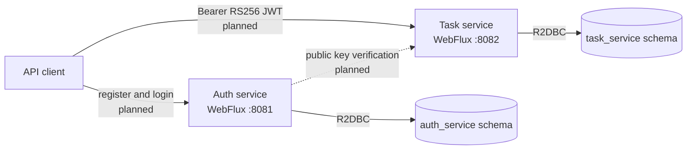

# Task Flow

Reactive task management built as two Spring Boot microservices.

This repository is currently at the foundation stage. Both services start, apply their own
Liquibase migrations, and expose health endpoints. Registration, JWT authentication, and task
CRUD are the next implementation stages.

## Architecture



The services share one PostgreSQL instance for local development but own separate schemas. They
do not read each other's tables, and the task schema deliberately has no foreign key to the user
schema. The future task API will take the owner ID from the JWT `sub` claim.


## Technology

- Java 21
- Spring Boot 4.1
- Spring WebFlux and Project Reactor
- Spring Data R2DBC with PostgreSQL
- Liquibase migrations using JDBC during startup
- Maven multi-module build
- JUnit 5 and Testcontainers

## Prerequisites

- Java 21 or newer
- Docker with Docker Compose

## Run locally

Start PostgreSQL:

```bash
docker compose up -d postgres
```

Start each service in a separate terminal:

```bash
./auth-service/mvnw -f pom.xml -pl auth-service spring-boot:run
```

```bash
./auth-service/mvnw -f pom.xml -pl task-service spring-boot:run
```

Check their health:

```bash
curl http://localhost:8081/actuator/health
curl http://localhost:8082/actuator/health
```

Both responses should contain:

```json
{"status":"UP"}
```

Stop the development database without deleting its volume:

```bash
docker compose down
```

## Test

```bash
./auth-service/mvnw -f pom.xml test
```

Each service test starts an isolated PostgreSQL container, applies its Liquibase changelog,
starts the application on a random port, and verifies its health endpoint. Docker must be running;
the development database does not need to be running.

## Configuration

Development defaults are defined in each service's `application.yaml`. Every value can be
overridden through environment variables documented in [.env.example](.env.example). Defaults are
local-only and must not be used as production credentials.

| Service | Port | Database schema | Liquibase changelog |
| --- | ---: | --- | --- |
| Auth | `8081` | `auth_service` | `auth-service/src/main/resources/db/changelog` |
| Task | `8082` | `task_service` | `task-service/src/main/resources/db/changelog` |

Application queries use R2DBC. Liquibase uses the PostgreSQL JDBC driver only while the service is
starting.

## Current API

| Method | Endpoint | Description |
| --- | --- | --- |
| `GET` | `http://localhost:8081/actuator/health` | Auth service health |
| `GET` | `http://localhost:8082/actuator/health` | Task service health |

The planned business API is not implemented yet. Its intended surface is:

| Method | Endpoint | Description |
| --- | --- | --- |
| `POST` | `/api/v1/auth/register` | Register a user |
| `POST` | `/api/v1/auth/login` | Authenticate and issue an RS256 JWT |
| `POST` | `/api/v1/tasks` | Create a task for the authenticated user |
| `GET` | `/api/v1/tasks` | List the authenticated user's tasks |
| `GET` | `/api/v1/tasks/{id}` | Read one owned task |
| `PUT` | `/api/v1/tasks/{id}` | Replace one owned task |
| `DELETE` | `/api/v1/tasks/{id}` | Delete one owned task |

## Key assumptions

- Email addresses will be unique user identifiers for login.
- JWTs will use RS256. Auth will keep the private key; task-service will receive only the public key.
- Task ownership will be derived from the token, never accepted from a request body.
- Dates will use PostgreSQL `DATE`; audit timestamps use time-zone-aware timestamps.
- One PostgreSQL instance is sufficient for this take-home project. Separate service schemas retain
  ownership boundaries without adding another container.
