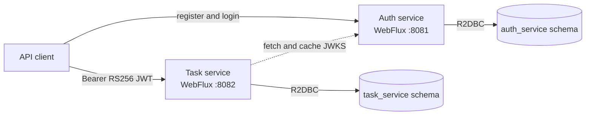

# Task Flow

Reactive task management built as two Spring Boot microservices.

Both services start, apply their own Liquibase migrations, and expose health endpoints. The auth
service supports registration and login with BCrypt password hashing and RS256 JWTs. Authenticated
users can create, list, read, update, and delete their own tasks through the task service.

## Architecture



The services share one PostgreSQL instance for local development but own separate schemas. They
do not read each other's tables, and the task schema deliberately has no foreign key to the user
schema. The task API takes the owner ID from the verified JWT `sub` claim.


## Technology

- Java 21
- Spring Boot 4.1
- Spring WebFlux and Project Reactor
- Spring Data R2DBC with PostgreSQL
- Liquibase migrations using JDBC during startup
- Maven multi-module build
- JUnit 5, Karate, and Testcontainers

## Prerequisites

- Java 21 or newer
- Docker with Docker Compose

## Run locally

Start PostgreSQL:

```bash
docker compose up -d postgres
```

Generate a local RSA key pair (the ignored `.secrets` directory keeps it out of Git):

```bash
mkdir -p .secrets
openssl genpkey -algorithm RSA -pkeyopt rsa_keygen_bits:2048 -out .secrets/jwt-private.pem
openssl pkey -in .secrets/jwt-private.pem -pubout -out .secrets/jwt-public.pem
```

Start each service in a separate terminal:

```bash
./auth-service/mvnw -f pom.xml -pl auth-service spring-boot:run
```

```bash
./auth-service/mvnw -f pom.xml -pl task-service spring-boot:run
```

Check their health:

```bash
curl http://localhost:8081/actuator/health
curl http://localhost:8082/actuator/health
```

Both responses should contain:

```json
{"status":"UP"}
```

Stop the development database without deleting its volume:

```bash
docker compose down
```

## Test

```bash
./auth-service/mvnw -f pom.xml test
```

Each service integration test starts an isolated PostgreSQL container and applies its Liquibase
changelog. Docker must be running; the development database does not need to be running.

Run the complete cross-service API suite with:

```bash
./auth-service/mvnw -f pom.xml verify
```

The `verify` lifecycle packages both applications, starts a fresh PostgreSQL container, generates
temporary RSA keys, launches auth-service and task-service on available ports, and runs Karate with
real access tokens. The suite covers the complete task lifecycle, stale updates, cross-user
isolation, authentication failures, and invalid inputs. Service processes and the database are
stopped after the run. Karate reports are written to `task-service/target/karate-reports`, and
service startup logs are written to `task-service/target/api-integration-logs`.

## Configuration

Development defaults are defined in each service's `application.yaml`. Every value can be
overridden through environment variables documented in [.env.example](.env.example). Defaults are
local-only and must not be used as production credentials.

Set `AUTH_JWT_PRIVATE_KEY` and `AUTH_JWT_PUBLIC_KEY` to external PEM resources in every deployed
environment. The private key must be PKCS#8 and the public key X.509 encoded. Never commit the
private key. Auth publishes only the public key at `/.well-known/jwks.json`; task-service discovers
it through `TASK_JWT_JWK_SET_URI` and does not need a local key file.

| Service | Port | Database schema | Liquibase changelog |
| --- | ---: | --- | --- |
| Auth | `8081` | `auth_service` | `auth-service/src/main/resources/db/changelog` |
| Task | `8082` | `task_service` | `task-service/src/main/resources/db/changelog` |

Application queries use R2DBC. Liquibase uses the PostgreSQL JDBC driver only while the service is
starting.

## Current API

| Method | Endpoint | Description |
| --- | --- | --- |
| `GET` | `http://localhost:8081/actuator/health` | Auth service health |
| `GET` | `http://localhost:8082/actuator/health` | Task service health |
| `GET` | `http://localhost:8081/.well-known/jwks.json` | Public JWT signing keys |
| `POST` | `http://localhost:8081/api/v1/auth/register` | Register a user |
| `POST` | `http://localhost:8081/api/v1/auth/login` | Authenticate and issue an RS256 JWT |
| `POST` | `http://localhost:8082/api/v1/tasks` | Create an owned task |
| `GET` | `http://localhost:8082/api/v1/tasks?limit=20` | List owned tasks newest first |
| `GET` | `http://localhost:8082/api/v1/tasks/{id}` | Read one owned task |
| `PUT` | `http://localhost:8082/api/v1/tasks/{id}` | Update an owned task |
| `DELETE` | `http://localhost:8082/api/v1/tasks/{id}` | Delete an owned task |

Registration accepts `email` and `password`; passwords must contain at least 8 characters and no
more than 72 UTF-8 bytes. Login returns `accessToken`, `tokenType`, and `expiresIn`. Authentication
failures use the same response for an unknown email and an incorrect password.

Task endpoints require `Authorization: Bearer <accessToken>`. Creation accepts:

```json
{
  "title": "Prepare release",
  "description": "Complete the release checklist",
  "status": "TODO",
  "dueDate": "2026-10-30"
}
```

`title` and `description` must not be blank, `title` is limited to 200 characters, and `status`
must be `TODO`, `IN_PROGRESS`, or `DONE`. The list endpoint defaults to 20 tasks and accepts limits
from 1 through 100. Clients cannot provide an owner ID; ownership always comes from the JWT.

Task responses include a numeric `version`. Updating a task uses the same editable fields as
creation and must include the version returned by the most recent read:

```json
{
  "title": "Ship release",
  "description": "Deploy the completed release",
  "status": "DONE",
  "dueDate": "2026-11-01",
  "version": 0
}
```

A successful update increments the version. An update with an older version returns
`409 STALE_TASK_VERSION`. Deleting an owned task returns `204 No Content`.

A missing task and a task owned by another user return `404 TASK_NOT_FOUND` for reads, updates,
and deletes, preventing the API from revealing whether another user's task exists.

## Key assumptions

- Email addresses will be unique user identifiers for login.
- JWTs use RS256. Auth keeps the private key and publishes its public key as JWKS; task-service
  fetches and caches that JWKS.
- Task ownership will be derived from the token, never accepted from a request body.
- Dates will use PostgreSQL `DATE`; audit timestamps use time-zone-aware timestamps.
- One PostgreSQL instance is sufficient for this take-home project. Separate service schemas retain
  ownership boundaries without adding another container.
