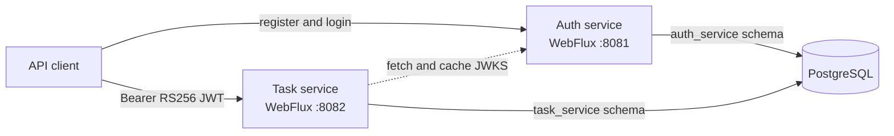

# Task Flow

Task Flow is a reactive task-management API built as two Spring Boot services. The auth service
registers users and issues RS256 JWTs; the task service uses those tokens to isolate every user's
tasks. Each service owns a PostgreSQL schema and its own Liquibase migrations.

## Quick start

You need Git, Docker with Compose, OpenSSL, and curl. Java is only required when running or testing
the services outside containers.

```bash
git clone https://github.com/LeandroTorresCoutinho/task-flow.git
cd task-flow
cp .env.example .env
mkdir -p .secrets
openssl genpkey -algorithm RSA -pkeyopt rsa_keygen_bits:2048 -out .secrets/jwt-private.pem
openssl pkey -in .secrets/jwt-private.pem -pubout -out .secrets/jwt-public.pem
docker compose up --build --detach --wait
```

The first build downloads the Java and Maven images and may take a few minutes. When Compose
finishes, auth is available at `http://localhost:8081` and tasks at `http://localhost:8082`.

Verify registration, login, task creation, update, read, and deletion with:

```bash
./scripts/smoke-test.sh
```

Expected output:

```text
Smoke test passed: registration, login, and task lifecycle
```

Inspect status or logs with `docker compose ps` and `docker compose logs`. Stop the stack while
preserving database data with `docker compose down`, or delete local data with
`docker compose down --volumes`.

## Architecture



The normal task request path does not call auth. Task-service verifies tokens locally from auth's
published JSON Web Key Set and takes the owner ID only from the verified JWT `sub` claim. The
[architecture decision record](docs/adr/0001-service-boundaries-and-data-ownership.md) explains the
trade-offs.

## API documentation

The versioned OpenAPI 3.1 contracts are:

- [Auth service API](docs/openapi/auth-service.yaml)
- [Task service API](docs/openapi/task-service.yaml)

The main endpoints are:

| Service | Method | Endpoint | Purpose |
| --- | --- | --- | --- |
| Auth | `POST` | `/api/v1/auth/register` | Register a user |
| Auth | `POST` | `/api/v1/auth/login` | Issue an access token |
| Auth | `GET` | `/.well-known/jwks.json` | Publish JWT verification keys |
| Tasks | `POST` | `/api/v1/tasks` | Create an owned task |
| Tasks | `GET` | `/api/v1/tasks?limit=20` | List owned tasks, newest first |
| Tasks | `GET` | `/api/v1/tasks/{taskId}` | Read an owned task |
| Tasks | `PUT` | `/api/v1/tasks/{taskId}` | Update with the latest `version` |
| Tasks | `DELETE` | `/api/v1/tasks/{taskId}` | Delete an owned task |

All task endpoints require `Authorization: Bearer <accessToken>`. A missing task and a task owned
by another user both return `404 TASK_NOT_FOUND`, so ownership is not disclosed. Updates use the
numeric `version` returned by the latest read and return `409 STALE_TASK_VERSION` if it is stale.

Both services expose unauthenticated health checks at `/actuator/health`.

## Configuration

Copy [.env.example](.env.example) to `.env` before starting Compose. Its database credentials and
published ports are local-development defaults; change them before using the stack in any shared
environment. Compose uses service names for internal database and JWKS URLs, so host port changes
do not break service-to-service communication.

The JWT private key must be unencrypted PKCS#8 PEM and the public key must be X.509 PEM. Compose
mounts them read-only from `.secrets`; both `.env` and `.secrets` are ignored by Git. Never commit a
private key.

| Variable | Default | Purpose |
| --- | --- | --- |
| `POSTGRES_DB` | `task_flow` | Local database name |
| `POSTGRES_USER` | `task_flow` | Local database user |
| `POSTGRES_PASSWORD` | `task_flow` | Local database password |
| `POSTGRES_PORT` | `5432` | PostgreSQL host port |
| `AUTH_SERVICE_PORT` | `8081` | Auth host port |
| `TASK_SERVICE_PORT` | `8082` | Task host port |
| `AUTH_JWT_KEY_ID` | `task-flow-key-1` | Published signing-key ID |
| `AUTH_JWT_TTL` | `PT1H` | Access-token lifetime |

The example file also documents every variable used when launching the services directly. In a
deployed environment, supply the keys through that platform's secret manager and set database
credentials and JWT issuer explicitly.

If you change the published service ports, pass their URLs to the smoke test:

```bash
AUTH_BASE_URL=http://localhost:9081 TASK_BASE_URL=http://localhost:9082 ./scripts/smoke-test.sh
```

## Develop from source

You need Java 21 and Docker. Start only PostgreSQL and generate keys as shown in Quick start, then
run the services in separate terminals:

```bash
docker compose up --detach postgres
./auth-service/mvnw -f pom.xml -pl auth-service spring-boot:run
```

```bash
./auth-service/mvnw -f pom.xml -pl task-service spring-boot:run
```

The services read the local defaults from their `application.yaml` files. Export values from
`.env.example` when you need to override them.

## Test

Run all unit tests:

```bash
./auth-service/mvnw -B -ntp -f pom.xml test
```

Run unit tests plus the cross-service Karate suite:

```bash
./auth-service/mvnw -B -ntp -f pom.xml verify
```

Docker must be running. The tests start isolated PostgreSQL containers; the development stack does
not need to be running. The cross-service suite packages and launches both services on available
ports, generates temporary keys, and covers authentication, validation, task lifecycle, stale
updates, and user isolation. Reports are written to `task-service/target/karate-reports` and startup
logs to `task-service/target/api-integration-logs`.

GitHub Actions runs the same `verify` command and a clean-checkout smoke job that builds the images,
starts the complete Compose stack, and executes `scripts/smoke-test.sh`.

## Technology

- Java 21 and Spring Boot 4.1
- Spring WebFlux, Spring Security, and Project Reactor
- Spring Data R2DBC with PostgreSQL
- Liquibase migrations over JDBC during startup
- Maven multi-module build
- JUnit 5, Karate, and Testcontainers
